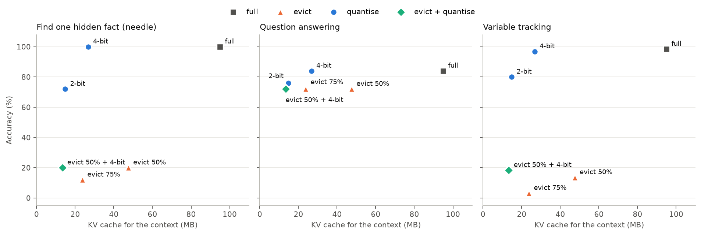
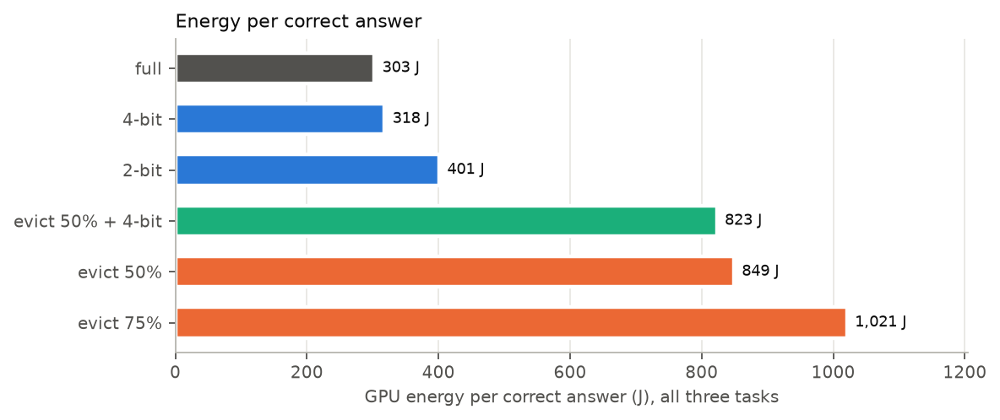

# Evict or quantize?

For long inputs, how do **H2O-style KV-cache eviction** (dropping tokens) and **KV-cache quantisation** (storing them in fewer bits) compare, do they combine, and does the answer change by task? Costs are measured on the GPU (latency and energy), not estimated from FLOPs.

> **Status:** full run complete (Kaggle T4, November 2026). Results are [below](#results), the summary files are in [`results/`](results), and [`analysis.ipynb`](analysis.ipynb) works through them. The full write-up is the [technical report](../../report/Gupta_2026_KV_cache_evict_vs_quantise.pdf).

## Design

**Model:** `Qwen/Qwen2.5-1.5B-Instruct` with eager attention, computed in float32 (see *Precision* below). It has 28 layers, 2 KV heads and head size 128, so 28.7 KB of 16-bit KV cache per token.

**Tasks:** RULER at 4,096 tokens ([`simonjegou/ruler`](https://huggingface.co/datasets/simonjegou/ruler)), 25 questions each, fixed seed.

| Task | Tests |
|---|---|
| `niah_single_1` | Retrieving one hidden fact |
| `vt` | Following chained variable assignments (multi-hop) |
| `qa_1` | Answering from real documents with distractors |

**Conditions:**

| Condition | Tokens evicted | KV bits | KV cache (whole model, 4k tokens) |
|---|---|---|---|
| `full_fp16` | 0% | 16 | 117.4 MB |
| `h2o_50` | 50% | 16 | 58.7 MB |
| `h2o_75` | 75% | 16 | 29.4 MB |
| `kv_int4` | 0% | 4 | 29.4 MB |
| `kv_int2` | 0% | 2 | 14.7 MB |
| `h2o_50+kv_int4` | 50% | 4 | 14.7 MB |

Two equal-memory pairs (`h2o_75` vs `kv_int4`, and `kv_int2` vs `h2o_50+kv_int4`) answer the headline question: at the same budget, drop tokens or lower precision?

The sizes in this table are for exactly 4,096 tokens. The measured sizes in the results are smaller because the RULER contexts average about 3,300 tokens, and the quantised ones include 0.5 bit per value for scales and offsets.

**KV quantisation:** a KIVI-style cache defined in the script (`--kv-backend kivi`, the default): keys grouped per channel over 64 tokens, values per token over 64 channels, round-to-nearest, newest 128 tokens kept in full precision. transformers' HQQ backend groups the flattened tensor, so once the context length is not a multiple of 128 its groups mix channels and Qwen2.5's outlier key channels wipe out the rest (4-bit outputs were gibberish). quanto's CUDA kernels do not compile on a T4. Both are still selectable for comparison.

**Precision:** the model runs in float32 (`--dtype`, the default). Qwen2.5 overflows in float16 and answers `!!!!`, and a T4 has no native bfloat16. KV sizes are still reported for a 16-bit cache, the standard deployment format, plus 0.5 bit per value for the quantisers' scales and offsets.

**Measured per answer:** score (RULER exact-answer match), latency, GPU energy (NVML), peak GPU memory and calculated KV-cache size.

## Run on Kaggle

1. Verify your phone number on Kaggle (needed for GPU and internet).
2. New notebook, then Settings: Accelerator **GPU T4 x2**, Internet **On**.
3. Optional but faster: create a **Read** token at huggingface.co (Settings > Access Tokens), then in the notebook open **Add-ons > Secrets**, add it with the label `HF_TOKEN` and attach it to the notebook. The script picks it up automatically; never paste the token into code.
4. Run:

```python
!git clone https://github.com/seshjuansauce/kv-cache-compression-bench.git
%cd kv-cache-compression-bench
!pip install -q -r requirements.txt
%cd experiments/evict_vs_quantize

# smoke test (about 5-10 minutes)
!CUDA_VISIBLE_DEVICES=0 python kv_eviction_vs_quant.py --n 2 --out smoke.csv

# full run: 6 conditions x 75 questions = 450 answers (about 40 minutes on a T4)
!CUDA_VISIBLE_DEVICES=0 python kv_eviction_vs_quant.py --n 25
!python kv_eviction_vs_quant.py --summarise
```

For the full run, use **Save Version > Save & Run All (Commit)** so it runs in the background; files in `/kaggle/working` are lost when an interactive session ends. Download the outputs from the version's Output tab.

The repo must be public for the `git clone` above to work without a token.

## Outputs

| File | Contents |
|---|---|
| `results.csv` | One row per answer: condition, task, score, latency, energy, peak memory, tokens, generated tokens, KV size, prediction, references |
| `summary.csv` | Accuracy per task and condition, plus mean KV size, latency, energy, peak memory, count and energy per correct answer |
| `energy_per_correct.csv` | Energy per correct answer, by condition and task |
| `equal_memory_pairs.csv` | The two equal-memory comparisons side by side |
| `accuracy_vs_kv.png` | Accuracy against KV size, one panel per task |

The files from the full run are in [`results/`](results), and [`analysis.ipynb`](analysis.ipynb) reads them and builds the tables and charts below.

## Results

Full run: Qwen2.5-1.5B-Instruct on a Kaggle T4, RULER at 4,096 tokens, 25 questions per task, 450 answers in all, run once. Accuracy is the RULER score (%). Energy is GPU energy from NVML, per answer.

| Condition | KV cache (MB) | Needle | QA | Variable tracking | Mean | Latency (s) | Energy per answer (J) | Energy per correct answer (J) |
|---|---|---|---|---|---|---|---|---|
| `full_fp16` | 95.0 | 100 | 84 | 98.4 | **94.1** | 4.29 | 285 | **303** |
| `kv_int4` | 26.7 | 100 | 84 | 96.8 | **93.6** | 4.52 | 298 | **318** |
| `kv_int2` | 14.8 | 72 | 76 | 80.0 | 76.0 | 4.62 | 305 | 401 |
| `h2o_50` | 47.5 | 20 | 72 | 13.6 | 35.2 | 4.53 | 299 | 849 |
| `h2o_75` | 23.8 | 12 | 72 | 3.2 | 29.1 | 4.49 | 297 | 1,021 |
| `h2o_50+kv_int4` | 13.4 | 20 | 72 | 18.4 | 36.8 | 4.59 | 303 | 823 |

**Equal-memory comparisons**

| Pair | KV cache (MB) | Needle | QA | Variable tracking | Energy per correct answer |
|---|---|---|---|---|---|
| `h2o_75` vs `kv_int4` | 23.8 vs 26.7 | 12 vs **100** | 72 vs **84** | 3.2 vs **96.8** | 1,021 J vs **318 J** (69% less) |
| `h2o_50+kv_int4` vs `kv_int2` | 13.4 vs 14.8 | 20 vs **72** | 72 vs **76** | 18.4 vs **80.0** | 823 J vs **401 J** (51% less) |





### Findings

1. **4-bit quantisation is nearly lossless.** The KIVI-style cache shrank to 28% of its size (3.6x smaller) with mean accuracy 93.6, against 94.1 for the full cache.
2. **At equal memory, quantising beats evicting by a wide margin.** At about 25 MB, the 4-bit cache found the hidden fact in 100% of cases against 12% for 75% eviction, and scored 96.8 against 3.2 on variable tracking.
3. **The cost of compression depends on the task.** Eviction cost little on general question answering (72 against 84) but erased exact recall. This eviction scores tokens before the question exists, so it cannot keep the facts the question will need.
4. **Memory saved was not energy saved at this length.** Every compressed condition used 4-7% more energy per answer than the full cache and ran 5-8% slower. At 4k tokens with one request at a time, the cache is small next to the weights, and compressing it adds work.
5. **Energy per correct answer separates the methods.** At equal memory, 4-bit quantisation needed 69% less energy per correct answer than 75% eviction, and 2-bit needed 51% less than eviction plus 4-bit. The saving comes from answers staying correct, not from cheaper queries.

### How the full run compares with the earlier checks

The full run confirms and sharpens what the small check runs (2 questions per task) suggested.

| Earlier check | Full run (25 per task) |
|---|---|
| In float16, every answer came out as `!!!!`: Qwen2.5 overflows in fp16 on a T4 | Run in float32; the baseline scores 94.1 on average |
| transformers' HQQ cache at 4 bits returned gibberish on every task, because it groups the flattened tensor and mixes channels | The KIVI-style cache (keys per channel, values per token) keeps 4-bit accuracy at 93.6, so the grouping, not the bit width, decided whether quantisation worked |
| At about 26-29 MB, 4-bit kept both needles while 75% eviction lost one, and all variable tracking | Same direction, now clear: needle 100 against 12, variable tracking 96.8 against 3.2 |
| Energy per answer looked about the same across conditions | Confirmed: compression saved no energy per answer at 4k tokens, and the difference only shows per correct answer |
| 2-bit looked surprisingly strong on the needle (2 of 2) | Lower with more questions (72 on the needle, mean 76.0): 2 bits costs real accuracy, but still far less than eviction at the same memory |

## Limitations

- The eviction is **H2O-style** (kvpress `ObservedAttentionPress`): it compresses once, after reading the context and before the question, with no recent-token window. The original H2O evicts continuously during generation.
- KV sizes are calculated from the model config, not measured. Quantised sizes include 0.5 bit per value for scales and offsets, but the codes are stored unpacked (uint8), so peak GPU memory does not show the saving.
- With 25 questions per task, differences under about 20 points are within noise. The headline gaps (needle 100 against 12, variable tracking 96.8 against 3.2) are far larger than that.
- One model, one context length, one GPU, one run. At 4k tokens the cache is small next to the weights, so no latency or energy gain per answer was expected, and none appeared. Longer contexts and batched requests are where cache compression should start to pay per answer.
- Energy is measured for the whole answer (reading the context and generating), on a GPU shared with nothing else.

## Planned extension

Question-aware eviction: place the question after the context and score tokens only by the question's attention (the SnapKV idea), to test whether the needle is lost because the press scores before the question exists. Details in the [documentation PDF](../../docs/kv_eviction_vs_quant_documentation.pdf).
